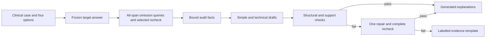

# TRUSTXAI

A local conversational workspace for **A Trustworthy & Explainable AI Framework for Large Language Model-Based Decision Support Systems**. The current research task is diagnostic decision support from clinical vignettes with four supplied candidate diagnoses.

**Master's thesis project author and repository owner:** Spandan Kumar Gope  
**GitHub:** [Spandan-Kumarr/TRUSTXAI](https://github.com/Spandan-Kumarr/TRUSTXAI)

The React interface provides a conversation sidebar, a central chat composer, light/dark themes, source cards and an evidence drawer. FastAPI runs real local models, records their observations and retains an exportable audit for each case. No GPT/Gemini API access is required.

## Run in the configured cloud workspace

```sh
cd /workspace/TRUSTXAI
./scripts/run.sh
```

Open **http://127.0.0.1:8000** in a browser attached to the same environment, or use the environment's port-forwarding facility. This is a local service, not a public deployment. The production frontend has already been built in this workspace.

If rebuilding the interface:

```sh
cd /workspace/TRUSTXAI/frontend
npm_config_cache=/workspace/thesis-runtime/cache/npm npm ci
npm_config_cache=/workspace/thesis-runtime/cache/npm npm run build
```

`scripts/run.sh` uses `/workspace/thesis-runtime/venv/bin/python`. `TRUSTXAI_PYTHON`, `TRUSTXAI_HOST` and `TRUSTXAI_PORT` override the interpreter, bind address and port. The default bind address is loopback. Model inference is offline and missing model assets produce an explicit failure rather than a substitute answer.

## Use the workspace

1. Select a labelled synthetic example or a public MedQA feasibility example, or enter a case and four candidate diagnoses. Imported text/JSON remains editable before submission.
2. Submit the case. The target model records one A–D option, makes fresh queries omitting each case span, and repeats the selected omission query.
3. Read the simple or technical explanation. Open **View evidence** for the exact spans, observed answer changes, recheck and explanation-check details.
4. Ask follow-up questions or use **Ask with sources** for questions about the recorded sources. Inspect the cited source cards and the reply's grounding status.
5. Export the case as JSON. Editing a submitted case creates a new version; it does not replace the original evidence.

The synthetic examples have no assigned clinical gold label. Public examples come only from the already-used feasibility pool; the application does not expose research development/test labels.

## Models and evidence flow

| Component | Current implementation |
| --- | --- |
| Diagnostic option selection | Qwen3-4B-Instruct-2507, pinned revision, greedy A–D, CPU FP32 |
| Explanation/chat generation | Official Qwen3-1.7B GGUF Q8_0, pinned revision, llama-cpp-python 0.3.16 |
| Automated support check | Pinned nli-deberta-v3-base plus typed identity/count/scope checks |
| Source retrieval | Local TF–IDF over seven recorded research/protocol notes plus active-case evidence |
| History and checker cache | SQLite outside the repository |



The interactive application's NLI threshold is **0.90, provisional**. The frozen Step 6 research runner used a separately recorded 0.60 fallback after no prespecified threshold retained 90% of supported-intent development variants. Neither value is a diagnostic confidence score or a clinically calibrated operating point. A failed generated pair is replaced with a labelled deterministic evidence template; that fallback does not count as successful LLM narrative generation. Exact original drafts and check outcomes remain in the audit/export.

Source cards distinguish curated public-research summaries, project protocol, supplied case findings and recorded model behavior. The public notes retain URLs and provenance hashes; they are **not verbatim publisher extracts**. The current chatbot searches this finite collection, not the entire web or a comprehensive clinical guideline library. Every released generated factual sentence requires a recognized citation and a passing automated support check. Otherwise, the interface displays labelled retrieved source notes.

## Runtime and development

The verified environment is Linux x86_64, CPU only, with approximately 33 GiB RAM. The final synthetic end-to-end browser check used about 18.93 GiB peak process RSS and 160 seconds; these are one-run observations, not a latency guarantee. Model loading, case length and number of spans affect runtime. The worker processes jobs serially and supports cancellation between bounded inference calls.

`requirements-app.txt` contains the HTTP/test additions to the existing inference environment. It is **not** a complete model-environment installer. Recorded package versions are in [APP_ENVIRONMENT.json](research/step-05/APP_ENVIRONMENT.json), model revisions in [MODEL_REVISIONS.json](research/step-04/evidence/MODEL_REVISIONS.json), and native-build provenance in [NATIVE_BUILD_PROVENANCE.json](research/step-04/clinical-cdss/evidence/NATIVE_BUILD_PROVENANCE.json). Model weights and downloaded raw data stay under `/workspace/thesis-runtime`, outside Git.

The manifests currently record the configured cloud model paths. A different machine requires provisioning the pinned assets/dependencies and updating those paths. `TRUSTXAI_RUNTIME` changes the runtime/data root, while model lookup uses the recorded manifests. MacBook M5/MPS execution and a fresh-machine installer have not been validated.

## Open the downloaded project in VS Code

Download the stable source archive from [TRUSTXAI v1.0.0](https://github.com/Spandan-Kumarr/TRUSTXAI/archive/refs/tags/v1.0.0.zip), or clone it with:

```sh
git clone https://github.com/Spandan-Kumarr/TRUSTXAI.git
```

Install Python 3.12, Node.js and Git, extract the project ZIP, then open the extracted `TRUSTXAI` folder in VS Code. In its integrated terminal run:

```sh
chmod +x scripts/setup-local.sh scripts/run.sh
./scripts/setup-local.sh
./scripts/run.sh
```

Open `http://127.0.0.1:8000`. The setup script creates `.venv`, installs the API/test dependencies, installs the locked frontend packages and builds the interface. This starts the application shell and API on macOS or Linux without using the cloud-specific Python path.

The GitHub/source ZIP intentionally excludes model weights, raw private cases, SQLite history and the cloud virtual environment. Consequently, diagnostic inference reports that assets are unavailable until the three pinned model assets are provisioned and their local paths are updated in the recorded manifests. The current full inference configuration is CPU FP32 and has not been validated on Apple Silicon/MPS. The research documents, source code, aggregate results and tests are included.

For frontend development, run `npm run dev` in `frontend/`; Vite proxies `/api` to the backend on port 8000. API documentation is available at `/docs`.

```sh
cd /workspace/TRUSTXAI
PYTHONPATH=backend /workspace/thesis-runtime/venv/bin/python -m pytest -q
cd frontend
PLAYWRIGHT_CHROMIUM_EXECUTABLE=/usr/bin/chromium npm run test:e2e
```

All 195 backend/research tests pass. The backend tests use protocol fakes; the browser suite uses explicitly labelled API fixtures. The production build and all four browser tests pass with the configured system Chromium. Real-model integration observations are recorded separately in [Step 5 delivery notes](research/step-05/STEP_05_DELIVERY.md).

The application stores case inputs, drafts, source snapshots and exports locally in `TRUSTXAI_APP_DATA` (default `/workspace/thesis-runtime/app`). Deleting a conversation hides it through soft deletion; it is not secure erasure of SQLite records. There are no user accounts or authentication. Use synthetic/public research cases in this local prototype.

## Research status

The application and frozen computational evaluation are complete as a research prototype. On the prespecified 60-case held-out MedQA subset, the target recorded 47/60 correct options (78.33%), 100% valid decisions and option-position macro-F1 0.7865. All 60 sources had informative omission evidence; 54/407 omissions changed the target answer and all 60 selected-result rechecks agreed.

The automated NLI operating target failed during development: every grid threshold rejected all 160 supported-intent controls. The declared 0.60 fallback likewise gave zero automated supported-pair yield on held-out natural outputs and 100% false rejection on the 240 supported-intent held-out controls. These are checker failure results, not evidence of improved explanation quality. Formal H1/H2/H3 remain untested until two real independent annotators complete the prepared blinded packets. Separate offline rater packages and a fail-closed agreement/adjudication/lock processor are ready. No GPT/Gemini comparison, audience study, clinical validation, deployment-safety result or publication/grade guarantee is claimed. See the [Step 6 delivery record](research/step-06/STEP_06_DELIVERY.md), [rater workflow](research/step-06/annotation/RATER_WORKFLOW.md), [clinical protocol](research/step-04/clinical-cdss/STEP_04_CLINICAL_PROTOCOL.md) and [application review](research/step-05/REVIEW_FINDINGS.md).
